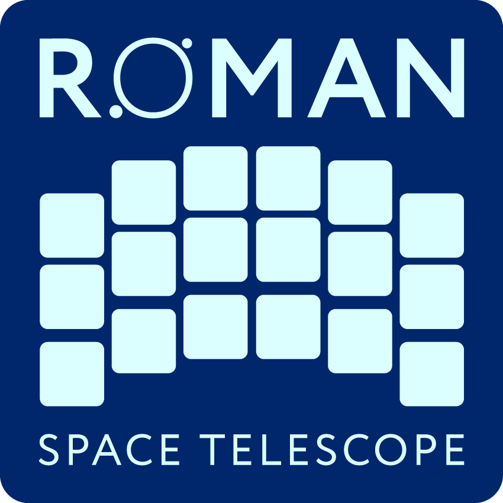

.. image:: _static/stsci_pri_combo_mark_horizonal_white_bkgd.png
   :width: 83%
   :target: https://stsci.edu

.. _rad:

**************************
Roman Attribute Dictionary
**************************

The Roman Attribute Dictionary (RAD) is a package which defines schemas for the Nancy Grace
Roman Space Telescope files. Metadata attributes are used by both Science Data Processing and
the Archive Keyword Dictionary.

.. note::
  These are schemas for the :ref:`ASDF file <asdf-standard:asdf-standard>` file format,
  used by ASDF to serialize and deserialize data for the Nancy Grace Roman Space Telescope.

Included Resources
==================

The following are listings of all the schemas provided by this package for ASDF.

.. note::
  Typically, schemas are used in ASDF via their tag, which can be found in the manifest.

.. toctree::
  :maxdepth: 1

  schemas.rst
  reference_files.rst
  manifests.rst
  ground_tests.rst
  ccsp.rst
  ssc.rst

Developer Resources
===================

.. toctree::
  :maxdepth: 1

  helper.rst
  creating.rst
  versioning.rst
  contributing.rst
  changes.rst
  legacy.rst

Index
=====

* :ref:`genindex`
